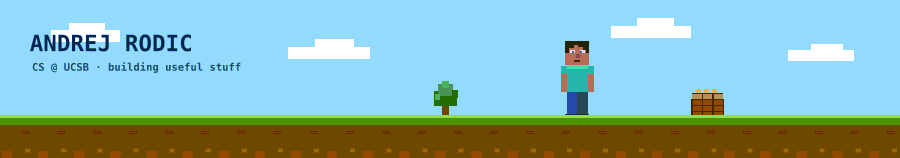
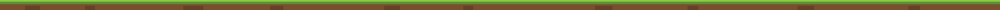

---

## ⛏️ about me

hey, i'm **Andrej**, a **Computer Science student at UC Santa Barbara**. i like building useful stuff, especially projects where code, electronics, and design work together.

when i'm not in class or working on a build, i'm usually playing soccer, filming youtube videos, or playing games like minecraft.

## selected projects

### Queue Monitor

i built and published a Chrome extension that watches Discord for new Minecraft skill-test queues and helps players join quickly. it now has **300+ users**.

**links:** [Chrome Web Store](https://chromewebstore.google.com/detail/mctiers-queue-sniper-watc/aibcfnkajkoandabcpbebgaijomadkjn) · [case study](https://github.com/AndrejRodic/queue-monitor-showcase)  
**stack:** JavaScript · Chrome APIs · Manifest V3 · Cloudflare Workers

---

### Roblox Development

i helped lead a three-person coding team building reusable Roblox game systems in Luau. Games using the team's templates reached **258.6K peak concurrent players** and **1.5B+ visits**. Separately, our asset packs had **100+ paid team sales**, and games using them reported **330K+ combined concurrent players**.

**links:** [case study](https://github.com/AndrejRodic/roblox-development)  
**stack:** Luau · Roblox Studio

---

### Sprint Timing Gates

i built a laser-sensor prototype that records sprint times.

**stack:** microcontroller · laser sensors

---

### Garage Parking Aid

i built a distance-sensing prototype with LED feedback to help a driver stop at the right spot.

**stack:** microcontroller · distance sensor · LED

---

## 🎒 inventory

**current goal:** looking for a software internship for Summer 2027.

more about me

- i designed, printed, and sold **240+ functional items** through a small 3D-printing shop.
- i ran an eBay resale business with **$5.6K in sales** and **217 positive reviews**.
- i co-created a Roblox animation channel with **7M+ views** and **9K subscribers**.
- i spent three years peer mentoring students and helped with tutoring and community service.

<picture>
  <source media="(prefers-color-scheme: dark)" srcset="./dist/github-contribution-grid-snake-dark.svg" />
  <source media="(prefers-color-scheme: light)" srcset="./dist/github-contribution-grid-snake.svg" />
  
</picture>

*last updated by GitHub Actions*

