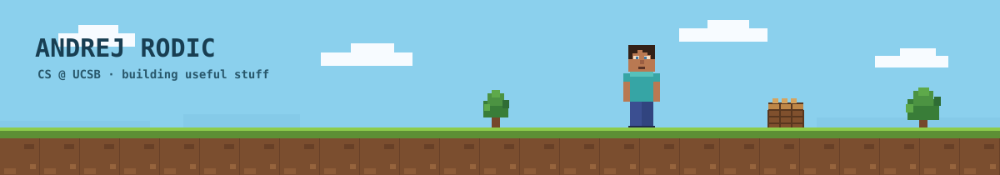

---

### `⛏️ whoami`

hey, i'm **Andrej**, a student studying Computer Science at **UC Santa Barbara**. i like building useful stuff, especially projects where code, electronics, and design work together.

when i'm not in class or working on a build, i'm usually playing soccer, filming youtube videos, or playing games like minecraft.

---

### `🧱 inventory`

---

### `🔥 active quests`

- **CS @ UCSB**
- building and shipping useful software
- currently looking for a **software internship**

---

### `🗺️ project log`

| Build | Notes |
| :-- | :-- |
| **Queue Monitor** | Published Chrome extension for Discord queues, used by **300+ people**. [Chrome Web Store](https://chromewebstore.google.com/detail/mctiers-queue-sniper-watc/aibcfnkajkoandabcpbebgaijomadkjn) · [case study](https://github.com/AndrejRodic/queue-monitor-showcase) |
| **Roblox templates** | Helped lead a three-person team building reusable Luau game systems. Games using our templates reached **258.6K peak CCU** and **1.5B+ visits**. [case study](https://github.com/AndrejRodic/roblox-development) |
| **Roblox asset packs** | Co-built packs with **100+ paid team sales**. Games using the packs reported **330K+ combined concurrent players**. [case study](https://github.com/AndrejRodic/roblox-development) |
| **Sprint Timing Gates** | Built a laser-sensor prototype that records sprint times. |
| **Garage Parking Aid** | Built a distance-sensing prototype with LED feedback to help drivers park. |

---

### `💎 achievements`

| Focus | Milestone |
| :-- | :-- |
| **3D printing** | Designed and sold **240+ functional items**. |
| **Online resale** | Sold digital in-game items on eBay, earning **$5.6K in sales** and **217 positive reviews**. |
| **Roblox animation** | Co-created a channel with **7M+ views** and **9K subscribers**. |
| **Peer mentoring** | Spent three years helping students with math and study strategies. |

---

### `🌿 lore`

- usually playing soccer, editing videos, or playing Minecraft

---

<picture>
  <source media="(prefers-color-scheme: dark)" srcset="./dist/github-contribution-grid-snake-dark.svg" />
  <source media="(prefers-color-scheme: light)" srcset="./dist/github-contribution-grid-snake.svg" />
  
</picture>

*last updated by GitHub Actions*

